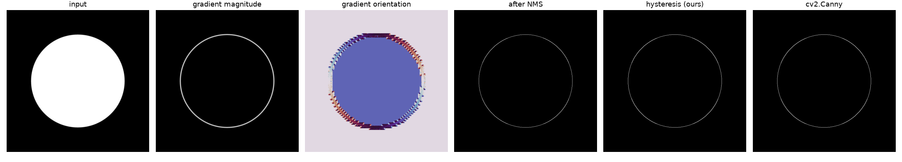
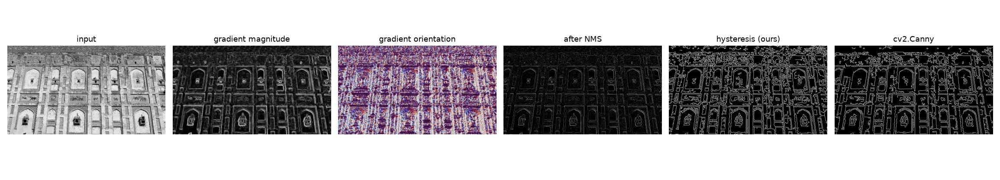
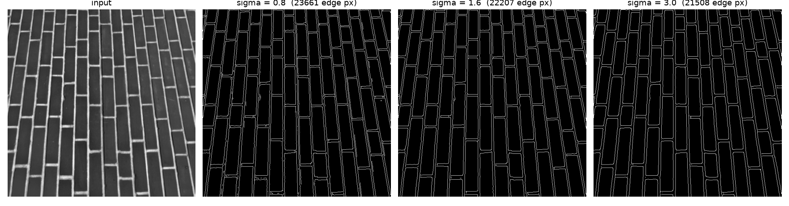

# 01 · Canny edge detection from scratch

> Completed: 2021-01-18T09:30:00Z (January 2021)

Edges are where image intensity changes fast. Canny's contribution is turning a noisy gradient map into thin, connected, single-pixel contours.

## Pipeline
```
gray image
  └─ Gaussian-derivative filters (σ) ──► Ix, Iy          smoothing + differentiation in one convolution
        └─ magnitude √(Ix²+Iy²), orientation atan2(Iy,Ix)
              └─ non-maximum suppression               keep only ridge pixels along the gradient direction (4 quantised angles)
                    └─ double threshold + hysteresis   strong pixels seed edges, weak pixels survive only if connected to one
```

## Theory in three lines
- Differentiating amplifies noise, so smooth first; convolving with the derivative of a Gaussian does both and σ sets the scale of the edges you see.
- NMS thins a wide gradient ridge to one pixel by comparing each pixel with its two neighbours across the edge.
- Hysteresis uses two thresholds: a single threshold either breaks edges (too high) or adds speckle (too low).

## Results (`python demo.py`)



| image | our edge px | OpenCV edge px | F1 vs `cv2.Canny` (1 px tolerance) |
|---|---|---|---|
| circle | 1454 | 1450 | **1.00** |
| checkerboard | 8400 | 8204 | **1.00** |
| Lahore fort wall (busy texture) | 33073 | 25725 | 0.86 (precision 0.77, recall 0.97) |



## Insights
- On clean geometry the from-scratch version is indistinguishable from OpenCV. On a heavily textured facade it finds more edges (recall 0.97, precision 0.77) because my thresholds are *relative* to the strongest edge in the image (10 % / 25 %) while OpenCV's are absolute (50 / 150). Relative thresholds adapt to contrast but let in more texture on low-contrast scenes: a real deployment decision.
- σ trades localisation for noise suppression: σ=0.8 keeps brick-level detail, σ=3 keeps only architectural outlines. Pick σ from the size of the structure you need, not by eye.
- Edge detection is the first step of the lane monitor ([04](../04_lane_detection)) and the document-edge detection in `document-capture`.

Files: `canny.py` (algorithm), `demo.py` (figures + metrics), `coursework_original/` (original 2021 assignment code, kept for reference).
