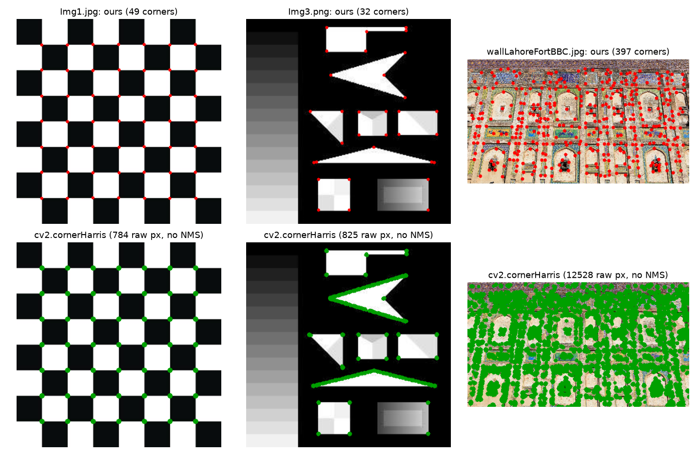
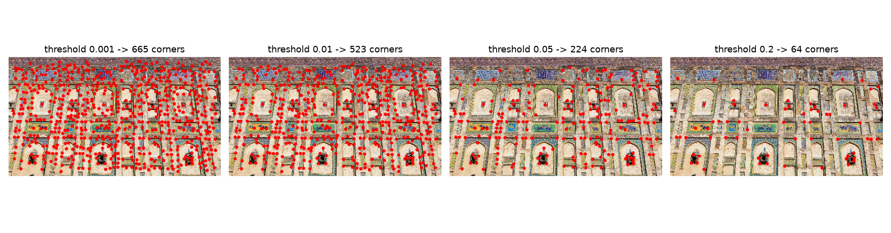
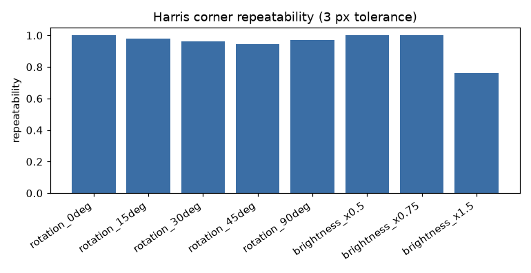

# 02 · Harris corner detection from scratch

A good feature is one you can find again in another view. Corners are good because shifting a window in *any* direction changes its content, unlike flat regions (no change) or edges (no change along the edge).

## Pipeline
```
gray ─► Gaussian blur ─► Ix, Iy (Sobel)
          └─ structure tensor  M = G_σ * [[Ix², IxIy],[IxIy, Iy²]]      (windowed sum of gradient outer products)
                └─ response  R = det(M) − k·trace(M)²                    (k ≈ 0.05)
                      └─ threshold  R > t·max(R)  +  7×7 local-maximum NMS  ─► corner list
```

## Theory
The eigenvalues λ1, λ2 of M describe how much gradient energy the window has along its two principal directions. Both large → corner; one large → edge; both small → flat. `det − k·trace²` scores that without computing eigenvalues.

## Results (`python demo.py`)

The checkerboard yields exactly the **49** interior corners of its 7×7 grid. OpenCV's raw response, shown without NMS, marks hundreds of adjacent pixels per corner; the local-maximum step is what makes it usable.


Threshold sweep on a textured facade: 665 → 523 → 224 → 64 corners at t = 0.001 / 0.01 / 0.05 / 0.2.



| transform | repeatability (corner re-found within 3 px) |
|---|---|
| rotation 15° / 30° / 45° / 90° | 0.98 / 0.96 / 0.94 / 0.97 |
| brightness ×0.5 / ×0.75 | 1.00 / 1.00 |
| brightness ×1.5 (clips highlights) | 0.76 |

## Insights
- **Rotation invariant, not scale invariant.** Repeatability stays above 0.94 under rotation (the structure tensor is rotation-covariant) but Harris has no scale selection, which is why SIFT/ORB add a scale pyramid ([07](../07_classical_cv_practice) uses SIFT).
- **Robust to affine intensity change, fragile to clipping.** Darkening leaves relative gradients intact; ×1.5 saturates bright regions and destroys 24 % of corners. Lesson for phone-photo pipelines: exposure clipping hurts feature detectors more than low light does.
- The threshold is an application knob, not a constant: calibration targets want few precise corners, tracking wants many.

Files: `harris.py`, `demo.py`, `coursework_original/`.
