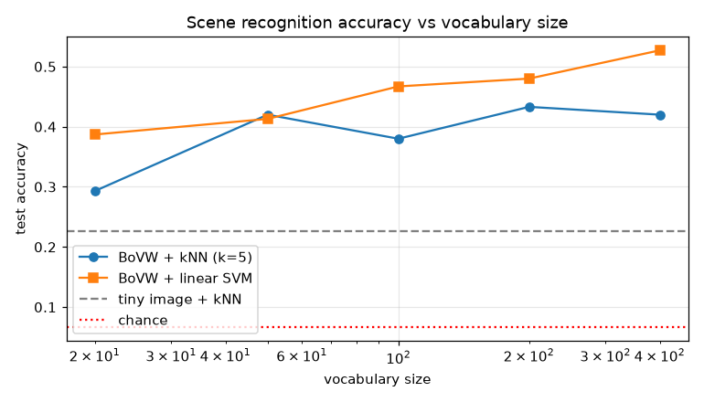
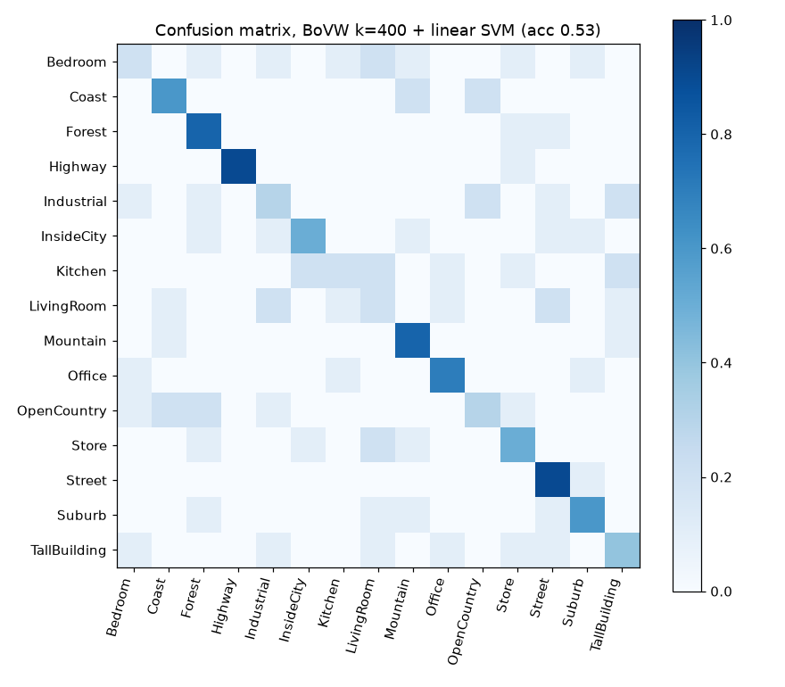

# 03 · Bag of visual words scene recognition

Classify a photo as *kitchen, forest, street…* without a neural network: describe it as a histogram of "visual words".

## Pipeline
```
image ─► dense SIFT (16 px patches every 8 px) ─► 128-d descriptors
train descriptors ─► k-means (k words) ─► vocabulary
image ─► assign each descriptor to its nearest word ─► L2-normalised histogram (length k)
histogram ─► classifier: kNN (own implementation, `knn.py`) or linear SVM
```

## Theory
Borrowed from text retrieval: ignore *where* a feature occurs and keep only *which* features occur and how often. This makes the descriptor robust to layout changes and cheap to compare. The price is that all spatial structure is lost, which is exactly what spatial pyramids and, later, CNNs recover.

## Data and protocol
15-scene categories (Lazebnik et al.), 40 images per class: 30 train / 10 test per class, so 450 train / 150 test, fixed seed. With only 150 test images, one accuracy figure is uncertain by about ±4 points, so differences smaller than that are not significant.

## Results (`python demo.py`)


| method | test accuracy |
|---|---|
| chance | 0.067 |
| tiny image (16×16 pixels) + kNN | 0.227 |
| BoVW k=50 + kNN / SVM | 0.420 / 0.413 |
| BoVW k=200 + kNN / SVM | 0.433 / 0.480 |
| **BoVW k=400 + linear SVM** | **0.527** |



## Insights
- Bag of SIFT words is **2.3× better than raw pixels** and 8× better than chance, with no learning beyond k-means and a linear classifier.
- Bigger vocabularies help the SVM steadily (0.39 → 0.53 from k=20 to 400). kNN saturates around 0.43: high-dimensional histograms make Euclidean neighbours less meaningful.
- **Outdoor scenes with distinctive texture are easy** (Highway 0.9, Street 0.9, Forest 0.8, Mountain 0.8). **Indoor scenes are hard** (Bedroom, Kitchen, LivingRoom all 0.2): they share the same local appearance (edges, furniture corners) and differ in layout, which BoVW discards. This is the classic argument for spatial pyramids, and for CNNs.
- Honest limits: small vocabulary-training set, single split. A production comparison would use the full dataset and cross-validation.

Files: `bovw.py` (features, vocabulary, histograms), `knn.py` (kNN from scratch), `demo.py`, `coursework_original/`.
