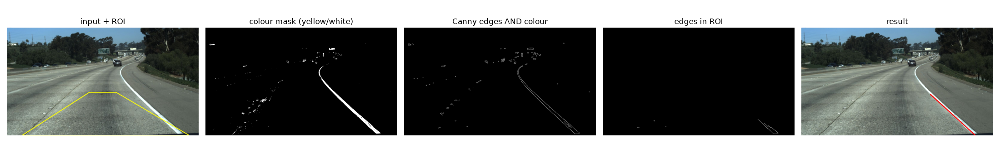
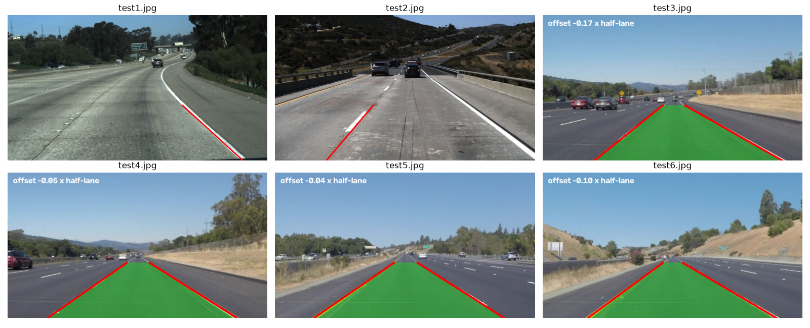

# 04 · Lane detection with classical computer vision

> Completed: 2021-04-22T08:05:00Z (April 2021)

Find the left and right lane markings in a dashcam frame and report where the vehicle sits in the lane. No learned weights.

## Pipeline
```
BGR frame
  ├─ HSV colour mask: yellow ∪ white paint
  ├─ Gaussian blur → Canny edges
  └─ AND  ──► trapezoid region of interest ──► probabilistic Hough segments
          ──► slope filter (reject horizontals / verticals) ──► split left (slope<0) / right (slope>0)
          ──► length-weighted line fit per side ──► lane polygon + lateral offset (× half-lane width)
```

## Theory
- Lane paint is the only thing on the road that is both *bright/yellow* and *edge-like*, so intersecting a colour mask with an edge map removes most clutter (cars, shadows, guard rails).
- Hough voting turns "find collinear edge pixels" into peak-finding in (ρ, θ) space and tolerates gaps between dashes.
- The ROI encodes a prior: lanes converge towards the vanishing point in front of the car.

## Results (`python demo.py`)



| | |
|---|---|
| frames where both lanes found | **4 / 6** |
| speed (960×540, one CPU core) | **≈ 4 ms / frame** (~250 FPS, detector only) |
| lateral offset on the 4 successes | −0.17, −0.05, −0.04, −0.10 × half-lane (vehicle slightly left of centre) |

## Insights
- **Fast and interpretable but brittle by design.** 4 ms/frame leaves a lot of headroom for real-time use on a CPU, and every failure can be traced to a stage. In both failures (top row) only one lane line is recovered: `test1` is a curved road, which a straight-line model fits poorly, and in `test2` the car is off-centre, so a marking probably falls outside the fixed trapezoid ROI (I did not isolate the cause). Fixes: polynomial/sliding-window fit in a bird's-eye view ([06](../06_image_rectification) provides the homography), temporal smoothing, or a learned segmentation model as the fallback.
- Hard-coded HSV thresholds are the weakest link at night, in rain and with worn paint; a production system should calibrate them or learn them.
- This is the prototype behind the fuller `lane-drift-monitor` project: tracking over time, metres instead of pixels and an alert policy are what turn a per-frame detector into a product.

Files: `lane.py`, `demo.py`, `coursework_original/` (original assignment scripts + notebook).
