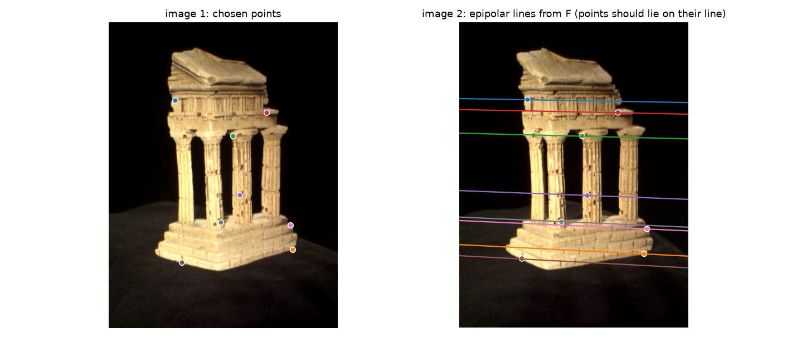
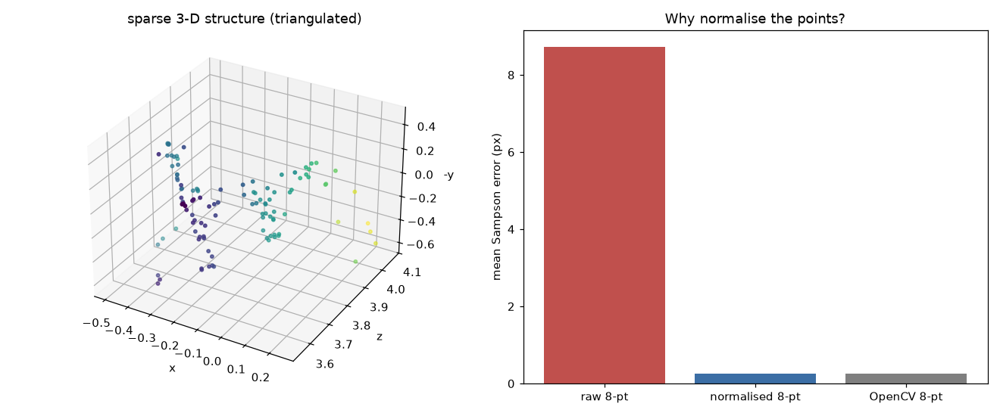

# 05 · Camera calibration and two-view geometry

How a 3-D point becomes a pixel, and how two pixels from two views constrain each other.

## Models
```
Pinhole camera:   [u v 1]ᵀ ~ P [X Y Z 1]ᵀ,   P = K [R | t]          (calibration: find P from known 3-D↔2-D pairs)
Epipolar geometry: x₂ᵀ F x₁ = 0,   F = K₂⁻ᵀ [t]ₓ R K₁⁻¹              (two uncalibrated views: find F from point matches)
Pipeline here:  DLT (SVD) → P → RQ decomposition → K, R, t
                8-point (Hartley-normalised) → F → E = K₂ᵀFK₁ → recoverPose → triangulate
```

## Theory
- **DLT:** each correspondence gives two linear equations in the 12 entries of P. Stack ≥ 6 points, take the right singular vector with the smallest singular value.
- **8-point:** each match gives one linear equation in the 9 entries of F; enforce rank 2 afterwards (a real F has a null space: the epipole).
- **Normalisation matters:** pixel coordinates (~10²) and the constant 1 differ by orders of magnitude, which wrecks the conditioning of the SVD. Translating to the centroid and scaling to mean distance √2 fixes it.

## Results (`python demo.py`)

Each coloured point in image 1 defines a line in image 2; the matching point lies on it.



| quantity | value |
|---|---|
| calibration, 20 points, noise-free reprojection RMSE | 0.003 image units (recovered K ≈ diag(2.55, 2.55)) |
| RMSE grows ~linearly with input noise | σ=0.005 → 0.005, σ=0.02 → 0.017, σ=0.05 → 0.040 |
| fundamental matrix, 110 matches, un-normalised 8-point | **8.72 px** mean Sampson error |
| fundamental matrix, **normalised** 8-point | **0.254 px** (34× lower; identical to OpenCV's 8-point) |
| rank of F | 2 |
| triangulated points, mean reprojection in view 2 | 1.0 px |

## Insights
- **Normalisation is a 34× accuracy fix for four lines of code**: the same algorithm, the same data. It is the single most important practical detail in this topic.
- DLT noise sensitivity is nearly linear (error ≈ 0.8 × input noise), so a calibration rig with many well-spread points averages the noise down.
- 8-point F uses *all* matches equally, so a few wrong matches would ruin it: in practice you wrap it in RANSAC ([07](../07_classical_cv_practice)).
- This is the geometry behind 3-D reconstruction, AR anchors, and measuring real distances from images (e.g. the lateral position in metres in the lane monitor).

Files: `geometry.py` (all algorithms), `demo.py`, `coursework_original/`.
