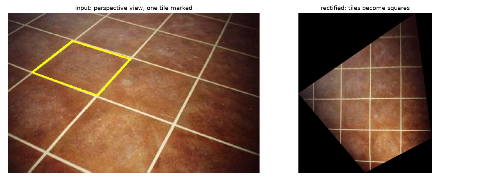
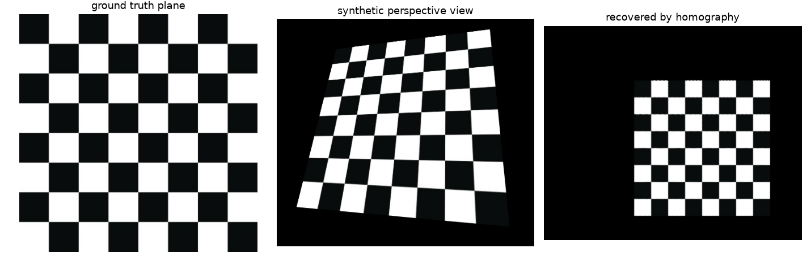
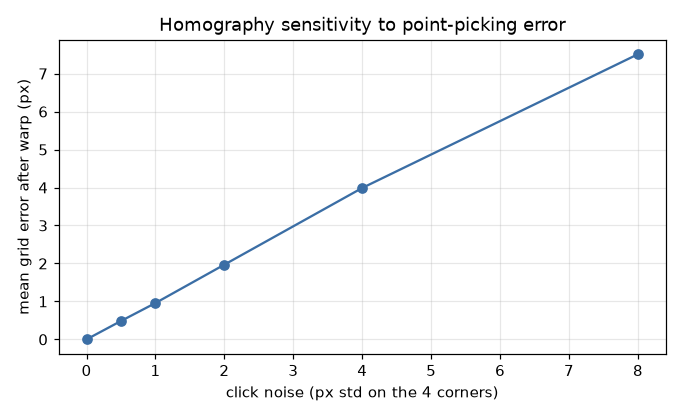

# 06 · Single-image rectification with homographies

> Completed: 2021-06-17T13:20:00Z (June 2021)

Undo perspective: a photo of a tiled floor (or a page, a road, a facade) becomes a fronto-parallel view where lengths and angles are meaningful again.

## Model
A plane seen by a pinhole camera is related to its true layout by a 3×3 **homography** H (8 degrees of freedom): `x' ~ H x`.
```
4 point pairs (image corners of a known rectangle/square ↔ target square)
   └─ Hartley normalisation → DLT → SVD → H
         └─ warpPerspective(image, H)
```

## Theory
Four correspondences, no three collinear, fix H exactly. Choosing them as the corners of something you know is a square (a floor tile, an A4 page, a lane section) defines the metric of the plane. Everything else on that plane is then rectified for free.

## Results (`python demo.py`)
Marking the four grout crossings around one tile (left) rectifies the whole floor (right): every tile becomes a square and the grout lines become parallel and perpendicular.



Synthetic ground truth: warp a checkerboard with a known homography, re-estimate H from noisy corner clicks, measure the error over a 9×9 grid.




| click noise on the 4 points (px) | 0 | 0.5 | 1 | 2 | 4 | 8 |
|---|---|---|---|---|---|---|
| mean grid error after warp (px) | 0.00 | 0.49 | 0.96 | 1.97 | 3.99 | 7.51 |

## Insights
- With exact points the recovery is exact (0.00 px), so the implementation is correct. With noise the output error is almost **1:1 with click error**: homographies from four points have no redundancy to average noise away.
- Practical consequences: click or detect points *far apart* (large baseline), use more than four points with least squares or RANSAC when you can, and refine corners to sub-pixel.
- This is the geometric core of document scanning (page corners → A4), bird's-eye lane views, and sports-field mapping. The production `document-capture` project automates the point selection.

Files: `rectify.py`, `demo.py`, `coursework_original/`.
