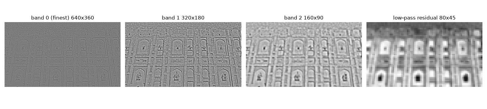
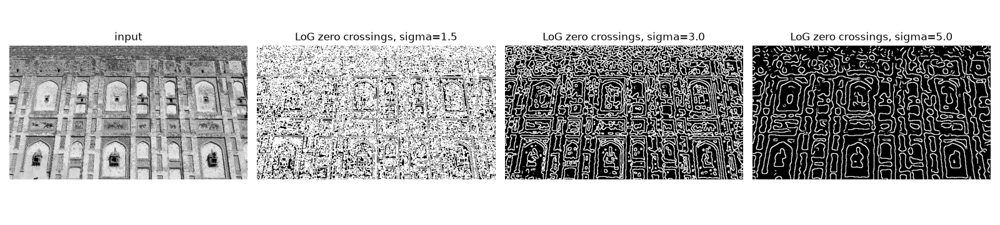
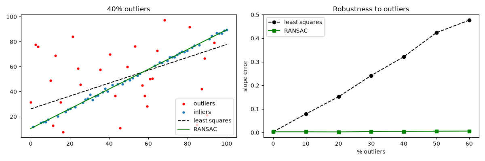
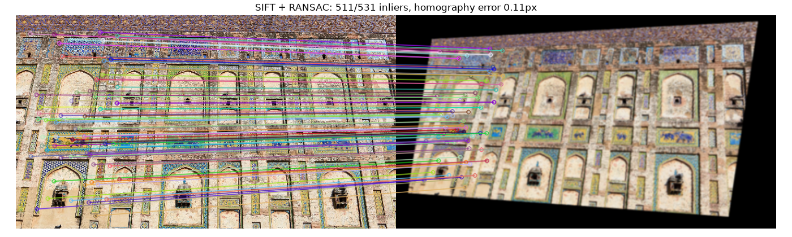
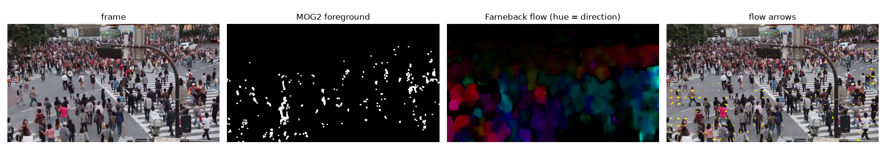

# 07 · Classical CV toolbox

Small, tested building blocks that every larger vision system leans on.

| block | what it does | theory in one line |
|---|---|---|
| Laplacian / Gaussian pyramids | multi-scale decomposition, lossless reconstruction | band-pass images = difference between a level and its up-sampled coarser level |
| Laplacian of Gaussian | blob/edge detection by zero crossings | second derivative changes sign at an edge |
| RANSAC | fit a model despite outliers | sample the minimal set, count consensus, refit on inliers |
| SIFT + RANSAC homography | match images across viewpoint change | scale-space keypoints + ratio test + geometric verification |
| Viola-Jones | fast face detection | Haar features + integral image + AdaBoost cascade |
| MOG2 / optical flow | motion in video | per-pixel Gaussian mixture background; Farneback dense flow |

## Results (`python demo.py`)
**Laplacian pyramid** reconstructs the image with a maximum absolute error of **0.0** (a lossless representation).

**RANSAC vs least squares**: slope error as outliers increase.

| outliers | 10 % | 30 % | 50 % | 60 % |
|---|---|---|---|---|
| least squares slope error | 0.079 | 0.242 | 0.424 | 0.476 |
| RANSAC slope error | 0.003 | 0.004 | 0.006 | 0.006 |

**SIFT + RANSAC** between an image and a perspective-warped, blurred copy: 2476 / 3031 keypoints, 531 ratio-test matches, **511 inliers (96 %)**, recovered homography within **0.11 px** of the truth.

**Video** (4-second street clip): background subtraction and dense optical flow.

## Insights
- Least squares degrades *linearly* with outliers; RANSAC is flat out to 60 %. Whenever correspondences come from a matcher, wrap the estimator in RANSAC ([05](../05_camera_calibration_epipolar) and [06](../06_image_rectification) both need it in practice).
- The ratio test + RANSAC pair is why SIFT matching works: the ratio test removes ambiguous matches cheaply, RANSAC removes the geometrically inconsistent ones (here 96 % of survivors are consistent).
- Background subtraction labels ~3.7 % of pixels as foreground in a busy scene; it is a cheap first stage before a detector, not a replacement.

Files: `basics.py` (pyramids, LoG, RANSAC), `demo.py`, `coursework_original/` (original practice scripts). The broken scratch `laplacian.py` from 2021 was replaced by the working `log_zero_crossings` in `basics.py`.
