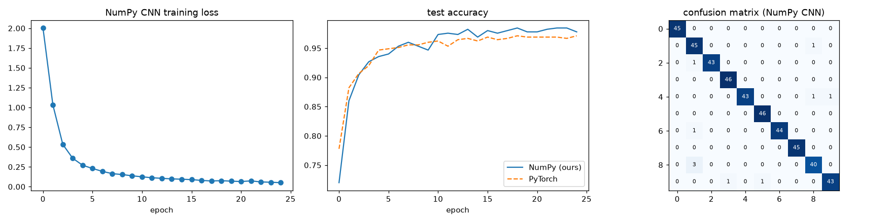
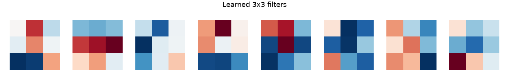
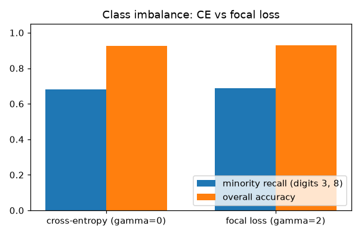

# 08 · A CNN in pure NumPy (forward and backward)

Writing the layers by hand is the fastest way to understand what a framework hides.

## Architecture
```
input 1×8×8 ─► Conv 3×3, 8 filters ─► ReLU ─► MaxPool 2×2 ─► Flatten (72) ─► Dense 10 ─► softmax ─► focal loss
               (sliding windows + einsum)                 (gradient routed to the arg-max, split across ties)
```
Every layer implements `forward` and `backward`; an Adam optimiser updates the parameters.

## Theory
- **Convolution** shares weights across positions (translation equivariance, few parameters). Backward is another convolution: `dW` correlates the input windows with the output gradient, `dx` scatters the gradient back through the kernel.
- **Max-pool** passes the gradient only to the winner of each window.
- **Focal loss** `FL = −(1−pₜ)^γ log pₜ` down-weights easy examples so rare/hard classes keep a gradient (γ = 0 is cross-entropy). Its derivative through the softmax is derived analytically in `cnn_numpy.py`.

## Results (`python demo.py`)



| check | result |
|---|---|
| numerical vs analytic gradient (max relative error), cross-entropy | **1.1 × 10⁻⁹** |
| same, focal loss γ = 2 | **2.5 × 10⁻¹⁰** |
| digits test accuracy: NumPy CNN vs identical PyTorch model | **97.8 % vs 97.1 %** (450 test images, 1 image = 0.22 pt) |
| training time, 25 epochs, CPU | 4.6 s vs 1.1 s |

Class-imbalance experiment: digits 3 and 8 reduced to 8 % of their training samples, 5 seeds.


| loss | minority recall (3, 8) | overall accuracy |
|---|---|---|
| cross-entropy | 0.682 | 0.927 |
| focal γ = 2 | 0.687 | 0.929 |

## Insights
- **Gradient checking is the test that matters.** It caught a false alarm worth knowing about: biases initialised to exactly zero put flat (all-black) patches exactly on the ReLU kink, where numerical and analytic derivatives legitimately disagree. Nudging the biases off zero gave 10⁻⁹ agreement.
- The from-scratch network matches PyTorch accuracy (the difference is 3 test images) at 4× the run time, which is the whole point of frameworks.
- **Focal loss did not help here** (0.682 → 0.687 is noise). On an easy 10-class problem the minority classes are already learnable from ~11 examples; focal loss earns its keep on extreme imbalance (detection with 1:1000 background:object), not on this. Reporting a null result is better than a cherry-picked one.

Files: `cnn_numpy.py` (layers, losses, optimiser, gradient check), `demo.py`, `coursework_original/` (the 2021 assignment: forward-only conv/pool/FC layers and a focal-loss class).
