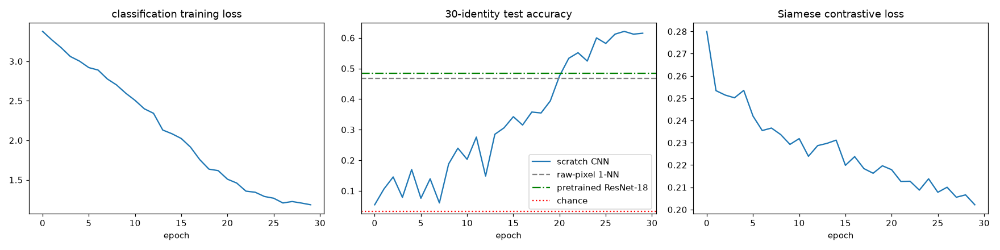
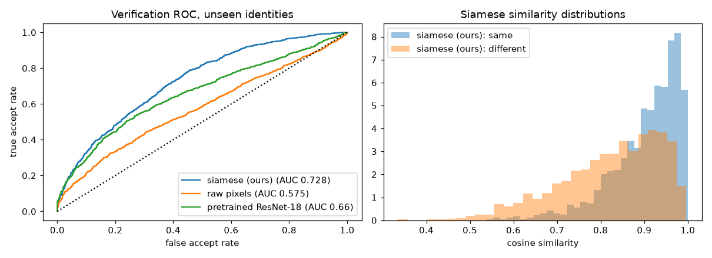

# 09 · Face recognition on CelebA: classification and Siamese verification

Two different questions about the same data:
- **Identification (closed set):** which of these 30 known people is this? → a classifier.
- **Verification (open set):** are these two photos the same person, even for people never seen in training? → learn an *embedding* and compare distances.

## Architecture
```
face crop 64×64 (aligned CelebA, hair/background trimmed)
   └─ [Conv3×3 → BN → ReLU → MaxPool] × 4  (32 → 64 → 128 → 192)
        └─ global average pool ─► Linear ─► 128-d embedding
              ├─ identification:  ReLU → Linear(30) → cross-entropy (label smoothing 0.1)
              └─ verification:    L2-normalise; Siamese pair (shared weights); contrastive loss
                                  L = y·d² + (1−y)·max(0, margin − d)²
```
Training uses flip / brightness / translation augmentation and AdamW with a one-cycle schedule.

## Theory
Classification learns decision boundaries for a *fixed* label set. Verification needs a metric space where same-identity photos are close and different-identity photos are far, so that new identities work without retraining. The Siamese setup trains this directly from pairs. Evaluation is by threshold-free metrics: ROC / AUC and the equal error rate (EER, where false accepts = false rejects).

## Data and protocol
Subset of CelebA (120 identities with ≥ 8 images, 4,315 images). Identification: the 30 identities with the most images, 70/30 split per identity (750 train / 330 test). Verification: identities split 84 train / **36 unseen test**, evaluated on 3,000 balanced pairs from the unseen identities. CelebA is licensed for non-commercial research, so face images are **not included** in this repo and the results below contain only curves and numbers. Run with `python demo.py --data PATH` where `PATH/<identity>/*.jpg` holds the crops.

## Results



**Identification, 30 classes (chance 3.3 %)**

| method | test accuracy |
|---|---|
| raw-pixel nearest neighbour | 46.7 % |
| ImageNet ResNet-18 features, nearest class centroid | 48.5 % |
| **small CNN from scratch + augmentation** | **61.5 %** |

**Verification on 36 unseen identities, 3,000 pairs**

| embedding | AUC | EER | best-threshold accuracy |
|---|---|---|---|
| raw pixels | 0.575 | 45.0 % | 56.8 % |
| ImageNet ResNet-18 | 0.660 | 38.0 % | 63.1 % |
| **Siamese CNN (ours)** | **0.728** | **34.4 %** | **66.8 %** |

## Insights
- **Task-specific training beats generic features, even from a tiny model with 750 images.** The ImageNet ResNet-18 knows about objects, not identity, so it only edges past pixels for identification and trails the Siamese model on verification.
- **Verification is much harder than identification** (66.8 % pair accuracy is far from deployable face verification, which needs millions of identities, margin-based losses such as ArcFace, and aligned high-resolution faces). The honest takeaway is the *methodology*: a train/test split by identity, threshold-free metrics, and baselines to prove the model learned something beyond pixels.
- Why identification (61.5 %) beat the raw-pixel baseline by only 15 points: CelebA photos of one person vary in pose, lighting and expression, and 25 images per person is a small training set.
- Next steps that would matter, in order: face-specific pre-training, a margin loss (ArcFace/CosFace) instead of contrastive, hard-pair mining, more identities.

Files: `faces.py` (data loader, CNN, contrastive loss, ROC/EER), `demo.py`, `coursework_original/` (the 2022 assignment scripts for classification, Siamese pairs and multi-label attributes).
