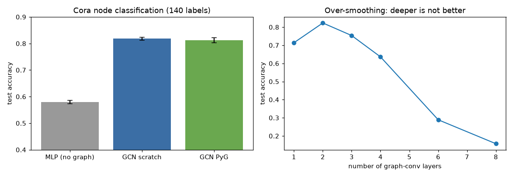
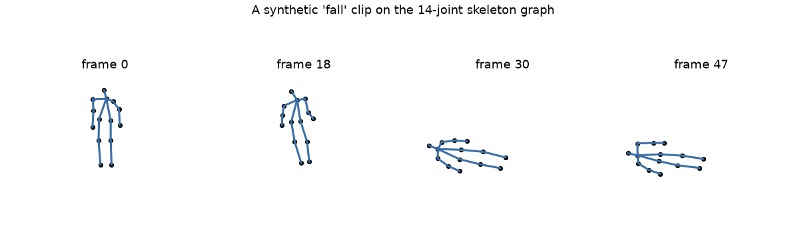
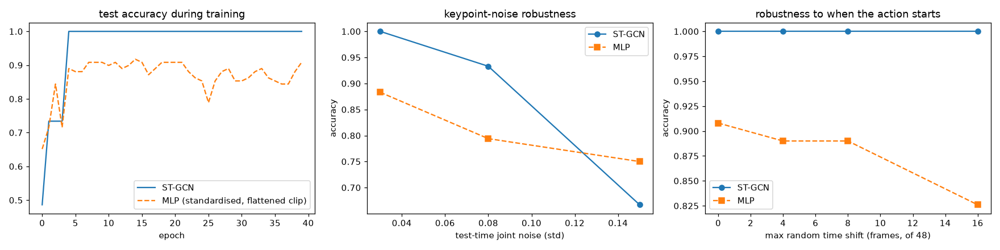

# 10 · Graph convolution networks, from Cora to skeleton sequences (ST-GCN)

Images are grids; many vision signals are graphs: a human skeleton, a scene graph, text components in a scene (the idea behind the Urdu text-detection thesis). Graph convolution is the layer that lets a network use that structure.

## Architecture
```
Node classification (Cora, 2,708 papers, 5,278 citations, 140 labels)
  X ─► A_hat · (X W₁) ─► ReLU ─► dropout ─► A_hat · (H W₂) ─► softmax        A_hat = D^-1/2 (A+I) D^-1/2

Skeleton ST-GCN block (input N × C × T frames × V joints)
  spatial:  1×1 conv, then mix each joint with its neighbours via A_hat   (which joints interact)
  temporal: 9×1 conv along time, BatchNorm, residual                      (how motion unfolds)
  3 blocks (32 → 64 → 64 channels, temporal stride 2) ─► global average pool ─► classifier
```

## Theory
- **GCN layer:** each node's new feature is a normalised average of its neighbours' (and its own) transformed features. The normalisation by degree stops high-degree nodes from dominating. Stacking k layers lets information travel k hops.
- **ST-GCN** factorises "what happens in a clip" into space (the body graph is fixed, so a sparse graph conv is enough) and time (an ordinary 1-D conv). Global pooling over time and joints makes the output independent of *when* the action starts.

## A. Cora results (`python demo_cora.py`)


| model | test accuracy (5 seeds) |
|---|---|
| MLP, features only | 0.579 ± 0.006 |
| **GCN written from scratch** (dense A_hat) | **0.818 ± 0.005** |
| GCN, PyTorch Geometric `GCNConv` | 0.812 ± 0.009 |

| graph-conv layers | 1 | 2 | 3 | 4 | 6 | 8 |
|---|---|---|---|---|---|---|
| test accuracy | 0.714 | **0.823** | 0.754 | 0.636 | 0.289 | 0.157 |

## B. Skeleton ST-GCN on synthetic clips (`python demo_skeleton.py`)
360 synthetic 48-frame clips on a 14-joint skeleton: *stand* (small sway), *walk* (random-phase limb swing), *fall* (progressive rotation about the ankles). 251 train / 109 test, one seed.




| | ST-GCN (97k params) | MLP on the flattened clip (259k params) |
|---|---|---|
| clean test accuracy | **1.000** | 0.908 |
| random time shift up to ±16 frames | **1.000** | 0.826 |
| joint noise σ = 0.08 | **0.933** | 0.794 |
| joint noise σ = 0.15 | 0.667 | **0.750** |

## Insights
- **Using the graph is worth +24 points on Cora** (0.58 → 0.82): with only 140 labelled nodes, neighbours supply most of the signal. The scratch GCN matches the library implementation to within noise, so the 15-line version is trustworthy.
- **Depth hurts.** Two layers is best; by eight layers accuracy collapses to 0.16 (about chance for 7 classes). Repeated averaging makes node features indistinguishable (over-smoothing), and deeper plain GCNs are also harder to optimise. Rather than going deeper, GCNs use skip connections, wide layers or attention.
- **ST-GCN's real advantage is invariance, not raw accuracy.** On clean data both work; once clips start at a different moment, the MLP drops 8 points and ST-GCN does not move, because temporal convolution + global pooling are shift-invariant while an MLP ties each frame to a fixed input slot. It also uses 2.7× fewer parameters.
- **A result against the model:** at the highest keypoint noise (σ = 0.15, larger than the sway signal) ST-GCN falls below the MLP. Nothing in the architecture protects it from garbage joints, which is why real fall-detection pipelines add keypoint confidence handling and smoothing.
- **Caveat:** the skeleton experiment is synthetic, with one seed and 109 test clips. It demonstrates the architecture and its invariances. It is *not* evidence of real-world fall-detection accuracy; that requires Le2i / UR Fall / MultipleCameraFall data and is what the full `early-fall-detection` project does.

Files: `gcn.py` (GCN, MLP, ST-GCN block, skeleton synthesiser), `demo_cora.py`, `demo_skeleton.py` (Cora is downloaded to `../data/cora` on first run), `coursework_original/` (original GCN assignment scripts; their Colab `!pip` lines are commented out so they parse).
