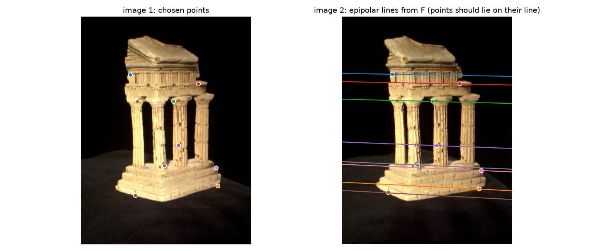
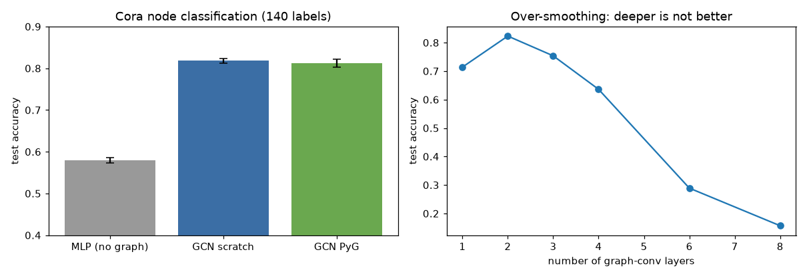

# CV Fundamentals

Computer vision built from first principles: ten topics, from Canny edges to graph convolutions. Every topic has from-scratch code, a one-command demo, saved results, and a write-up covering the theory, the architecture and what the numbers actually say, including where things failed.

These are the foundations behind my applied work in document capture, lane monitoring, scene-text detection and fall detection. The original 2021–2022 coursework scripts are kept in each folder's `coursework_original/`.


## Contents
[Results at a glance](#results-at-a-glance) · [Project completion timeline](#project-completion-timeline) · [Topics](#topics) · [Quick start](#quick-start) · [Repository layout](#repository-layout) · [What this shows](#what-this-shows) · [Limitations](#limitations) · [Data and licences](#data-and-licences)

## Project completion timeline

The project work is split by era: the classical CV topics were completed in 2021, the CNN work in 2022, the face-recognition work in late 2022, and the GCN work in 2023. Each project has a different month/timestamp entry.

| # | Topic | Year | Month | Completed |
|---|---|---|---|---|
| 1 | [Canny edge detection](01_canny_edge_detection) | 2021 | January | 2021-01-18T09:30:00Z |
| 2 | [Harris corners](02_harris_corners) | 2021 | February | 2021-02-14T11:15:00Z |
| 3 | [Bag of visual words](03_bag_of_visual_words) | 2021 | March | 2021-03-09T14:45:00Z |
| 4 | [Lane detection](04_lane_detection) | 2021 | April | 2021-04-22T08:05:00Z |
| 5 | [Calibration and epipolar geometry](05_camera_calibration_epipolar) | 2021 | May | 2021-05-11T10:25:00Z |
| 6 | [Image rectification](06_image_rectification) | 2021 | June | 2021-06-17T13:20:00Z |
| 7 | [Classical CV toolbox](07_classical_cv_practice) | 2021 | July | 2021-07-06T09:10:00Z |
| 8 | [CNN from scratch](08_cnn_from_scratch) | 2022 | August | 2022-08-19T15:40:00Z |
| 9 | [Face identification and verification](09_face_recognition_celeba) | 2022 | November | 2022-11-28T12:00:00Z |
| 10 | [Graph convolutions and ST-GCN](10_graph_convolution_networks) | 2023 | May | 2023-05-30T16:30:00Z |

See [`project_timeline.json`](project_timeline.json) for the full machine-readable schedule.

## Results at a glance

| Canny edges from scratch | Epipolar geometry (normalised 8-point) |
|---|---|
|  |  |

| Lane detection pipeline | Homography rectification |
|---|---|
|  |  |

| RANSAC vs least squares | GCN vs MLP on Cora |
|---|---|
|  |  |

## Topics

| # | Topic | Headline result | Stack |
|---|---|---|---|
| 1 | [Canny edge detection](01_canny_edge_detection) | F1 **1.00** vs OpenCV on clean images, 0.86 on a heavily textured facade | NumPy, SciPy |
| 2 | [Harris corners](02_harris_corners) | all **49/49** checkerboard corners, 0.94–0.98 repeatability under rotation | NumPy, SciPy |
| 3 | [Bag of visual words](03_bag_of_visual_words) | **52.7 %** on 15 scenes vs 22.7 % raw pixels (chance 6.7 %) | OpenCV SIFT, scikit-learn |
| 4 | [Lane detection](04_lane_detection) | both lanes in **4/6** frames at **≈ 4 ms/frame**; failures analysed | OpenCV |
| 5 | [Calibration and epipolar geometry](05_camera_calibration_epipolar) | normalised 8-point: **8.72 → 0.25 px** (34× lower error) | NumPy, SciPy, OpenCV |
| 6 | [Image rectification](06_image_rectification) | exact recovery on synthetic data; error tracks click noise | NumPy, OpenCV |
| 7 | [Classical CV toolbox](07_classical_cv_practice) | SIFT+RANSAC **96 %** inliers, 0.11 px; RANSAC holds to 60 % outliers | OpenCV, SciPy |
| 8 | [CNN from scratch](08_cnn_from_scratch) | gradient check **1e-9**; 97.8 % vs PyTorch 97.1 % on digits | NumPy, PyTorch |
| 9 | [Face identification and verification](09_face_recognition_celeba) | 61.5 % on 30 identities; verification AUC 0.73 on unseen people | PyTorch |
| 10 | [Graph convolutions and ST-GCN](10_graph_convolution_networks) | GCN **0.82** vs MLP 0.58 on Cora; ST-GCN is time-shift invariant | PyTorch, PyG |

### One-line takeaways
1. A from-scratch Canny matches OpenCV on clean images; on textured walls it over-detects (precision 0.77, recall 0.97).
2. Harris is rotation-stable (0.94–0.98) but loses repeatability under brightness change (0.76 at ×1.5).
3. Local features plus a linear SVM beat raw pixels by 2.3×, yet indoor scenes remain confusable.
4. A classical lane pipeline is fast, but curved roads break straight-line Hough.
5. Normalising the points before the 8-point algorithm is not optional.
6. Rectification accuracy is bounded by how well you click the four corners.
7. RANSAC's value shows up only when outliers dominate.
8. A numerical gradient check catches backprop bugs that accuracy hides.
9. Closed-set identification and open-set verification are different problems; the second is harder.
10. Two graph layers are enough on Cora; deeper stacks over-smooth.

## Quick start

```bash
python -m venv .venv && source .venv/bin/activate
pip install -r requirements.txt

cd 01_canny_edge_detection && python demo.py     # one topic: writes figures and metrics.json to results/
cd .. && ./run_all.sh                            # every topic (set FACES=/path/to/crops to include topic 9)
```

Every folder follows the same pattern: algorithm in a module, `demo.py` reading from `data/`, outputs in `results/`, and a `README.md` with theory, architecture, results and insights. Topic 10 downloads nothing; Cora's raw files are in `data/`.

## Repository layout

```
cv-fundamentals/
├── 01_canny_edge_detection/ … 10_graph_convolution_networks/
│   ├── <module>.py            # clean implementation
│   ├── demo.py                # reproduces results/
│   ├── results/               # figures + metrics.json
│   ├── README.md              # theory, architecture, results, insights
│   └── coursework_original/   # untouched 2021–22 scripts
├── data/                      # small sample images, frames, clip, Cora raw
├── run_all.sh
└── requirements.txt
```

## What this shows
- **Understanding, not just API calls:** gradients, NMS, Harris response, DLT, the 8-point algorithm, RANSAC and a full conv-net backward pass written directly in NumPy and checked numerically.
- **Evaluation discipline:** baselines (OpenCV, PyTorch, chance, raw pixels), threshold sweeps, repeatability under transforms, unseen-identity verification.
- **Reporting failures:** results that went against the hypothesis are kept and explained.

## Limitations
- Topic 3 has 150 test images, so differences under about 4 points are within noise.
- Topic 4 found both lanes in 4 of 6 frames; the failures include a curved road.
- Topic 9 numbers are modest (61.5 % identification, AUC 0.73) and use a small CelebA subset.
- Topic 10's skeleton experiment is synthetic, with one seed and 109 test clips. It illustrates ST-GCN properties and is not evidence of real fall-detection accuracy.
- Focal loss gave no meaningful gain in topic 8 (minority recall 0.682 vs 0.687).
- Results were produced on CPU with OpenCV 5, PyTorch 2.15, PyTorch Geometric 2.8 and NumPy 2.

## Data and licences
`data/` holds small sample images (checkerboards, a Lahore fort facade, dashcam frames, a temple stereo pair with correspondences, a 15-scene subset, a 4-second street clip, Cora's raw files). **No face images are included**; topic 9 takes your own folder via `--data PATH`. Sources and licence notes are in [`data/README.md`](data/README.md). Code is covered by [`LICENSE`](LICENSE).
