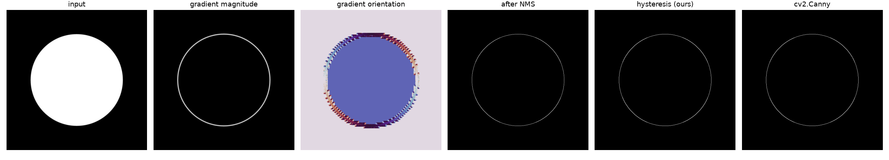
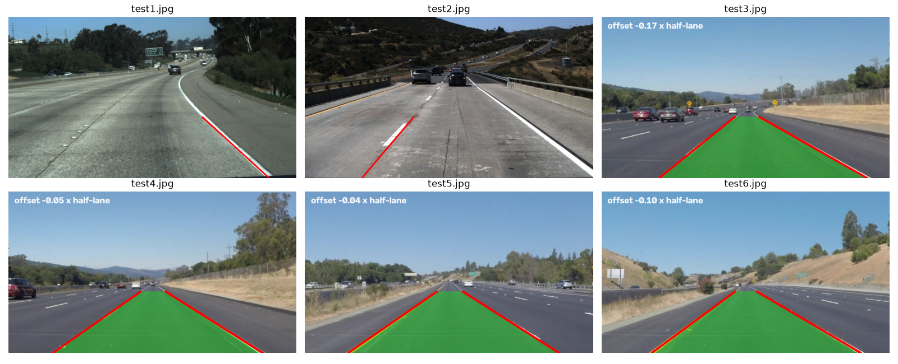
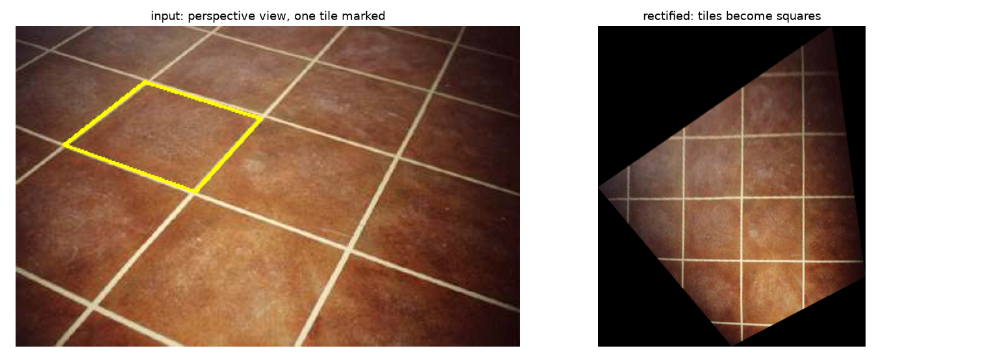

# CV Fundamentals

Computer vision built from first principles. Each topic has clean from-scratch code, a one-command demo, saved results, and a short write-up covering the theory, the architecture and what the numbers actually say (including where things failed).

These are the foundations behind my applied work: document capture, lane monitoring, scene-text detection and fall detection. The original 2021–2022 coursework scripts are kept in each folder's `coursework_original/`.

| # | Topic | Headline result | Stack | Folder |
|---|---|---|---|---|
| 1 | Canny edge detection | F1 **1.00** vs OpenCV on clean images, 0.86 on a heavily textured facade | NumPy, SciPy | [01](01_canny_edge_detection) |
| 2 | Harris corners | all **49/49** checkerboard corners, ≥ 0.94 repeatability under rotation | NumPy, SciPy | [02](02_harris_corners) |
| 3 | Bag of visual words | **52.7 %** on 15 scenes vs 22.7 % raw pixels (chance 6.7 %) | OpenCV SIFT, scikit-learn | [03](03_bag_of_visual_words) |
| 4 | Lane detection | both lanes in **4/6** frames at **≈ 4 ms/frame**; failures analysed | OpenCV | [04](04_lane_detection) |
| 5 | Calibration and epipolar geometry | normalised 8-point: **8.72 → 0.25 px** (34× better) | NumPy, SciPy, OpenCV | [05](05_camera_calibration_epipolar) |
| 6 | Image rectification | exact recovery; error ≈ 1:1 with click noise | NumPy, OpenCV | [06](06_image_rectification) |
| 7 | Classical CV toolbox | SIFT+RANSAC **96 %** inliers, 0.11 px; RANSAC flat to 60 % outliers | OpenCV, SciPy | [07](07_classical_cv_practice) |
| 8 | CNN from scratch (forward + backward) | gradient check **1e-9**; 97.8 % vs PyTorch 97.1 % on digits | NumPy, PyTorch | [08](08_cnn_from_scratch) |
| 9 | Face identification and verification | 61.5 % on 30 identities; verification AUC 0.73 on unseen people | PyTorch | [09](09_face_recognition_celeba) |
| 10 | Graph convolutions and ST-GCN | GCN **0.82** vs MLP 0.58 on Cora; ST-GCN invariant to time shift | PyTorch, PyG | [10](10_graph_convolution_networks) |

## A few results

| Canny from scratch | Normalised 8-point and structure |
|---|---|
|  |  |

| Lane detection | Rectification |
|---|---|
|  |  |

## Run it

```bash
python -m venv .venv && source .venv/bin/activate
pip install -r requirements.txt
cd 01_canny_edge_detection && python demo.py      # writes figures and metrics.json to results/
```
Every folder follows the same pattern: algorithm in a module, `demo.py` that reads from `data/`, saves figures and `results/metrics.json`. Topic 9 needs your own CelebA crops (`--data PATH`); topic 10 downloads Cora on first run (`demo_cora.py`).

## Data
`data/` holds small public sample images (checkerboards, a Lahore fort facade, dashcam frames, a temple stereo pair with correspondences, a 15-scene subset, a 4-second street clip, Cora's raw files). No faces are included. See [`data/README.md`](data/README.md).

## Honest notes
- Topic 3 uses 150 test images, so a difference under about 4 points is within noise; topic 10's skeleton experiment is synthetic, one seed.
- Results were produced on CPU with OpenCV 5, PyTorch 2.15 (CPU), PyTorch Geometric 2.8, NumPy 2.
- Where my result went against the hypothesis (focal loss, ST-GCN under heavy noise, the 2 lane-detection failures) it is reported as such.
